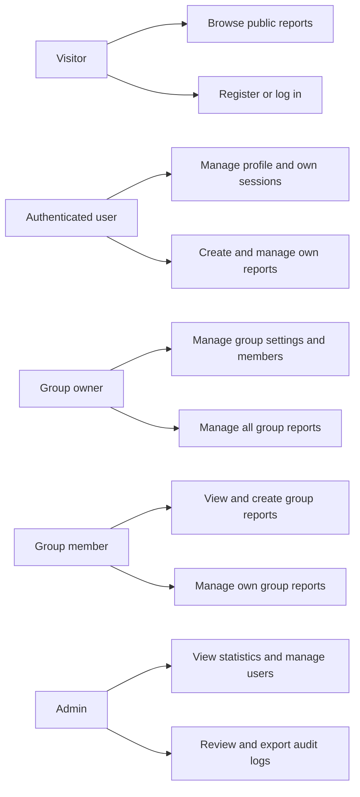
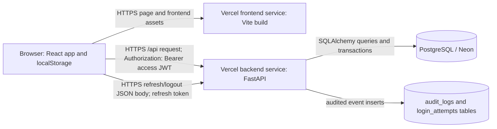
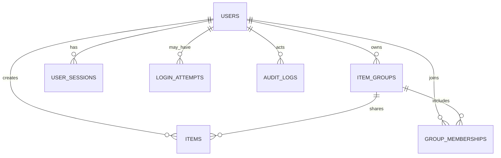
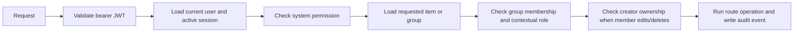
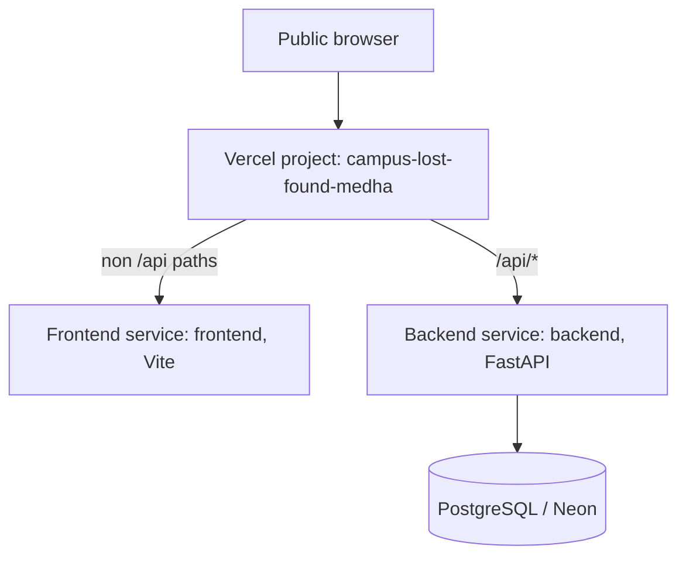

# Independent University, Bangladesh
## CSE309 Web Application & Internet
## Final Project Submission Report

**Project title:** Smart Campus Lost and Found<br>
**Student name:** [Pending: enter the submitting student's full name]<br>
**Student ID:** [Pending]<br>
**Section:** [Pending]<br>
**Team number:** [Pending, if applicable]<br>
**Semester:** Autumn 2026<br>
**Submission date:** [Pending]<br>
**Submitted to:** Sayef Reyadh, Adjunct Lecturer, Department of Computer Science & Engineering<br>
**GitHub repository:** <https://github.com/2222497-gif/2222497-Zarin-smart-campus-lost-and-found><br>
**Vercel frontend:** <https://campus-lost-found-medha.vercel.app>

> **Evidence and accuracy note:** This report distinguishes implementation visible in the repository, automated/local verification, and the most recently recorded live deployment verification. Screenshots, demo accounts, the final PDF, and demo video were not found in the repository during this review. Their absence is marked **Pending**; no accounts, screenshots, sample records, or results have been fabricated. Production database contents and credentials were not inspected.

## Table of Contents

- 1. Executive Summary
  - 1.1 Project overview
  - 1.2 What was built since the mid assessment
  - 1.3 Live links
- Part A. Product Requirements (PRD)
  - A1. Problem Statement
  - A2. Users and Roles
  - A3. Goals and Success Measures
  - A4. Scope and Non-Goals
  - A5. User Stories
- Part B. Software Requirements (SRS)
  - B1. Introduction
  - B2. Functional Requirements
  - B3. Non-Functional Requirements
  - B4. Roles and Permission Matrix
  - B5. Use Cases
  - B6. Acceptance Criteria
  - B7. Traceability Matrix
- Part C. Technical Design (TDD)
  - C1. Technology Stack
  - C2. System Architecture
  - C3. Backend and Frontend Structure
  - C4. Data Model
  - C5. API Design
  - C6. JWT Authentication Design
  - C7. RBAC Design
  - C8. Admin Dashboard Design
  - C9. Security Design and Threats
  - C10. Deployment on Vercel
  - C11. Testing
- Part D. Evidence: Screenshots of the Running Application
  - D1. User Side
  - D2. Security Behaviour
  - D3. Admin Dashboard
  - D4. Deployment
  - D5. Tests
- Part E. Project Management and Conclusion
  - E1. How to Run and Test
  - E2. GitHub Work
  - E3. Limitations
  - E4. Future Work
  - E5. Sources, Libraries and Tools

**List of Figures and Screenshots:** Figures are described in Part C; required screenshots S1-S21 are listed in Part D. Screenshots and final page numbers remain pending until captured and assembled in the PDF.

**List of Figures and Screenshots**

| Number | Caption | Page |
|---|---|---|
| Figure 1 | Use-case diagram | Pending |
| Figure 2 | System architecture | Pending |
| Figure 3 | Entity relationship diagram | Pending |
| Figure 4 | JWT/session sequence diagram | Pending |
| Figure 5 | Authorization flow | Pending |
| Figure 6 | Vercel deployment layout | Pending |
| S1 | Signup and login with validation error | Pending |
| S2 | Logged-in item page, search/filter, and report workflow | Pending |
| S3 | Profile and rejected incorrect-current-password attempt | Pending |
| S4 | Sessions list and session revocation | Pending |
| S5 | Group members and owner/member permissions | Pending |
| S6 | RBAC denial and matching HTTP 403 | Pending |
| S7 | Masked Authorization header and expired-token HTTP 401 | Pending |
| S8 | Refresh request and returned token (storage differs from requested cookie) | Pending |
| S9 | Banned user rejected on next request | Pending |
| S10 | Admin overview statistics | Pending |
| S11 | Admin user search, filters, and pagination | Pending |
| S12 | Admin user detail with sessions/activity (feature not implemented) | Pending / unavailable |
| S13 | Ban action and resulting banned state | Pending |
| S14 | Moderation list and bulk action (feature not implemented) | Pending / unavailable |
| S15 | Activity/audit log and triggering events | Pending |
| S16 | Failed logins by IP and account (view is partial) | Pending |
| S17 | Downloaded/opened audit CSV | Pending |
| S18 | Vercel frontend production deployment and domain | Pending |
| S19 | Vercel API environment variable names with values hidden | Pending |
| S20 | Live API documentation | Pending |
| S21 | Automated test output | Pending |

# 1. Executive Summary

## 1.1 Project overview

Smart Campus Lost and Found is a web application for campus visitors and signed-in users to browse, search, and report lost or found items. Signed-in users can manage their profile, password, and sessions. Group owners and members can share group-scoped item reports under fixed owner/member permissions. Administrators can view platform statistics, search and paginate users, change roles, ban or unban users, review login attempts and audit logs, and export audit logs as CSV.

**Stack:** React 19 with TypeScript and Vite; FastAPI and SQLAlchemy; PostgreSQL through psycopg (Neon is the intended/production database provider); Vercel Services.

## 1.2 What was built since the mid assessment

- **JWT authentication and sessions:** registration, login, short-lived signed access tokens, rotating refresh tokens, logout, session listing, and session revocation.
- **Role-based access control and group sharing:** reusable backend permission checks, item ownership enforcement, group owner/member permissions, membership management, and confirmed group archiving that preserves item rows.
- **Admin dashboard:** platform statistics, searchable and filtered paginated user list, role changes, ban/unban, login-attempt display, audit-log display, and CSV export.
- **Audit and login controls:** authentication and important item/group/account actions are recorded; repeated failed logins for an email are rate-limited.
- **Production deployment:** the public Vercel project `campus-lost-found-medha` serves the React application and routes API calls to FastAPI. The latest verified production commit is `9c8f6dc`.

The implementation does not include every dashboard/security feature listed in the instructor's requirements. Missing and partial items are identified in Parts B, C, and E rather than presented as completed.

## 1.3 Live links

**Table 1. Project links and current verification**

| Resource | Link or status |
|---|---|
| GitHub repository | <https://github.com/2222497-gif/2222497-Zarin-smart-campus-lost-and-found> |
| Production frontend | <https://campus-lost-found-medha.vercel.app> — public; latest recorded deployment Ready at commit `9c8f6dc` |
| API health | <https://campus-lost-found-medha.vercel.app/api/health> — latest recorded response: HTTP 200 |
| Items API | <https://campus-lost-found-medha.vercel.app/api/items> — latest recorded response: HTTP 200; browser frontend request was observed |
| API documentation | **Pending:** the live documentation URL was not confirmed in the deployment verification available for this report |
| Demo video | **Pending:** 5-8 minute video has not been supplied |
| Test account IDs/passwords | Not included here; create and verify the required accounts, then place credentials only in the PDF appendix |

# Part A. Product Requirements (PRD)

## A1. Problem Statement

Students who lose personal belongings on campus may not know where to report them or how to find reports made by other students. Reports can be scattered across informal messages or shared spaces, making it difficult to search by item, location, or date and to contact the person who reported a found item.

The project addresses that coordination problem with a campus-focused service for lost/found reports. Group sharing supports reports intended for a defined campus group while keeping the original reporter attached to each item. Account and administrator controls are intended to protect access and support platform oversight.

## A2. Users and Roles

**Table 2. Users and roles**

| Role | Who they are | Main tasks | What they must never be able to do |
|---|---|---|---|
| Visitor | A person not signed in | Browse and search public, ungrouped reports; register or log in | Create, edit, or delete reports; view group-only items or group details |
| User | An authenticated account holder who is not acting as a member/owner of a particular group | Create reports, manage own profile/password/sessions, search reports, create groups | Edit/delete another user's ungrouped item; access groups they do not belong to |
| Group member | An authenticated user with a membership row for a group | View group items, create group items, edit/delete only their own group items | Edit/delete another member's item; manage group settings or membership; transfer item ownership |
| Group owner | The user recorded as the group's `owner_id` | View/manage all items in the group, manage membership/settings, archive the group | Access a different group's private data without membership/ownership; change an item's original creator |
| Admin | An account with the `admin` system role | View statistics/users/login attempts/audit logs, change roles, ban/unban users, export logs | Bypass group membership for private group items; ban or demote their own account through the implemented admin controls. **The code does not prevent an admin from banning another admin.** |

Group owner/member are contextual group roles stored through group ownership and membership, not additional values in the system-wide `users.role` field.

## A3. Goals and Success Measures

**Table 3. Goals and measures**

| ID | Goal | Measure and observed status |
|---|---|---|
| G-01 | Make reports searchable and usable by visitors | Item list supports text search and Lost/Found filtering in the frontend. Live `/api/items` returned HTTP 200 in the latest recorded deployment verification. |
| G-02 | Protect signed-in operations | Missing, invalid/tampered, and expired access tokens are expected to return HTTP 401; the automated test `test_missing_invalid_and_expired_access_tokens_return_401` covers these cases. |
| G-03 | Enforce ownership and group boundaries | Automated tests cover another user's ungrouped item edit/delete denial, group visibility, member/owner permissions, and membership removal. |
| G-04 | Keep sessions revocable | Refresh-token rotation, old access-token invalidation, logout, session listing, and revocation are covered by two session tests. |
| G-05 | Support administrator oversight | Statistics, user search/filter/pagination, ban/unban, login attempts, audit records, and CSV export are implemented. Several requirements such as user detail, moderation, filters on audit/security views, and bulk actions remain incomplete. |
| G-06 | Provide public production access | Latest recorded Vercel status: Ready at `9c8f6dc`; public frontend, `/api/health`, and `/api/items` were verified. |
| G-07 | Prepare reproducible demo access | Required two admin and three normal user demo accounts and realistic demo records: **Pending**; none are documented or seeded by this repository. |

## A4. Scope and Non-Goals

**In scope**

- Registration, login, profile and password update, access/refresh tokens, logout, and user-owned session management.
- Public and group-shared lost/found reports, search/filter, ownership restrictions, and image selection.
- Fixed group owner/member permissions, group settings, membership management, and non-destructive group archiving.
- Admin statistics, user list and role/ban controls, login-attempt and audit-log views, and audit CSV export.
- FastAPI backend, SQLAlchemy data model, PostgreSQL-compatible persistence, automated API tests, and Vercel deployment.

**Out of scope in the current implementation**

- Per-member configurable group permissions; group permissions are fixed by owner/member role.
- Item ownership transfer or deletion as a side effect of membership removal or group archive.
- Admin content/group moderation, bulk user actions, admin access to group items without group membership, and an admin-wide session-revocation interface.
- User-detail screens with session/activity history, audit-log filters, or a security analytics view grouped by account/IP.
- Refresh-token delivery through an HttpOnly cookie; the current frontend stores tokens in `localStorage`.
- Email verification, password reset, and account recovery flows.

Some of these were requested by the instructor's sample. They are implementation gaps, not evidence that the requirements were waived.

**Assumptions and constraints**

- The application is a browser-based React frontend and FastAPI API deployed as services in one Vercel project.
- Backend configuration is supplied through environment variables; local `.env` files are not included in this report.
- `VITE_API_URL` may be blank when the frontend uses Vercel's same-origin `/api/*` rewrite.
- The project uses a PostgreSQL-compatible database; production records and schema were not inspected during this report revision.
- The frontend includes responsive CSS breakpoints, but a full device/browser compatibility matrix has not been documented.
- The final demo requires real, safe test accounts and realistic records in an approved demo database. This report does not create them.

## A5. User Stories

**Table 4. User stories**

| ID | User story | Implementation status |
|---|---|---|
| US-01 | As a visitor, I want to register with my name, email, and password so that I can report an item. | Implemented |
| US-02 | As a user, I want to log in and refresh my session so that I can continue using protected features. | Implemented; refresh token is stored in browser `localStorage` |
| US-03 | As a user, I want to update my profile and password so that my account information stays current. | Implemented |
| US-04 | As a user, I want to review and revoke my own sessions so that I can end access from another device. | Implemented |
| US-05 | As a user, I want to create and search lost/found reports so that campus items can be returned. | Implemented |
| US-06 | As a user, I want to attach an image to a report so that an item can be recognized. | Implemented as a base64 data URL with a 1 MB client-side size limit |
| US-07 | As a group owner, I want to create a group and add/remove members so that reports can be shared with a defined group. | Implemented |
| US-08 | As a group member, I want to view group reports and manage only the reports I created so that shared ownership rules are respected. | Implemented and covered by API tests |
| US-09 | As a group owner, I want to manage group settings and any report in my group so that the group remains manageable. | Implemented |
| US-10 | As a group owner, I want to archive a group only after confirmation while preserving item rows. | Implemented and covered by an API test |
| US-11 | As an admin, I want to see high-level platform statistics so that I can monitor system activity. | Implemented |
| US-12 | As an admin, I want to search, filter, and paginate users so that I can find accounts to manage. | Implemented |
| US-13 | As an admin, I want to change a user's role and ban/unban that account so that I can manage access. | Implemented; the separate admin safety rule preventing action against another admin is missing |
| US-14 | As an admin, I want to review audit activity and export it as CSV so that I can retain an activity record. | Implemented without audit filters |

# Part B. Software Requirements (SRS)

## B1. Introduction

This SRS records the observable requirements and current implementation status for Smart Campus Lost and Found. It is intended for the student, instructor, tester, and maintainer. A status of **Gap** or **Partial** is an honest indication that a requested requirement is not fully implemented or verified.

**Definitions**

| Term | Definition |
|---|---|
| JWT | JSON Web Token; a signed token carrying claims used by the API to authenticate a request |
| Access token | Short-lived bearer JWT sent in the `Authorization` header |
| Refresh token | Opaque random token exchanged for a new access/refresh pair; only its hash is stored by the backend |
| RBAC | Role-based access control; a permission decision based on system role and, for groups, owner/member status |
| Role | System role (`user` or `admin`) or contextual group role (`owner` or `member`) |
| Permission | Named action such as `admin:access`, `group:item:view`, or `group:manage-members` |
| Audit log | Database record of an actor, action, target, details, and timestamp |

**Relevant references (confirm which were consulted during implementation before final submission)**

- RFC 7519, JSON Web Token (JWT): <https://www.rfc-editor.org/rfc/rfc7519>
- FastAPI documentation: <https://fastapi.tiangolo.com/>
- SQLAlchemy documentation: <https://docs.sqlalchemy.org/>
- React documentation: <https://react.dev/>
- Vercel documentation: <https://vercel.com/docs>
- Repository implementation and test sources listed in Part C and Part E.

## B2. Functional Requirements

Each requirement below begins with “The system shall” and has a unique ID. **Implemented** means visible in source; **Tested** means the listed behavior also has automated test coverage; **Partial** and **Gap** identify limitations.

**Table 5. Functional requirements — FR-AUTH**

| ID | Requirement | Status / evidence |
|---|---|---|
| FR-AUTH-01 | The system shall allow a visitor to register with a valid name, email, and password and reject a duplicate email. | Implemented; registration route and schema validation |
| FR-AUTH-02 | The system shall verify a submitted password against a stored password hash and return a generic invalid-credentials response for an incorrect email/password pair. | Implemented; `pwdlib` recommended password hasher; invalid credentials return 401 |
| FR-AUTH-03 | The system shall use a separately managed password pepper in addition to the password hash. | **Gap:** no pepper is read or applied in the authentication code |
| FR-AUTH-04 | The system shall issue an access JWT with user, role, session, token-ID, issued-at, and expiry claims and enforce a configurable lifetime no greater than 15 minutes. | Implemented; default 15 minutes; configuration validation limits it to 1-15 |
| FR-AUTH-05 | The system shall issue a refresh token, store only its hash, rotate it on refresh, and reject reuse of the previous token. | Implemented and tested; refresh token is returned in JSON and stored in browser `localStorage`, not an HttpOnly cookie |
| FR-AUTH-06 | The system shall support logout by revoking the corresponding server-side session. | Implemented; logout endpoint revokes a matching active session |
| FR-AUTH-07 | The system shall allow a signed-in user to list and revoke only that user's sessions. | Implemented and tested |
| FR-AUTH-08 | The system shall limit repeated failed login attempts and record login outcomes. | Implemented: five failures for the same email within 15 minutes lead to HTTP 429; **not covered by the current automated tests** and not limited by source IP |
| FR-AUTH-09 | The system shall allow a signed-in user to update their own name and email and to change their password after verifying the current password. | Implemented; wrong current password returns 400 |
| FR-AUTH-10 | The system shall reject a missing, invalid, tampered, or expired access token on a protected route with HTTP 401. | Implemented and tested |
| FR-AUTH-11 | The system shall reject a banned user on the next protected request and prevent that user from refreshing a session. | Implemented in authentication and refresh checks; no dedicated automated test found |

**Table 6. Functional requirements — FR-RBAC**

| ID | Requirement | Status / evidence |
|---|---|---|
| FR-RBAC-01 | The system shall distinguish the system roles `user` and `admin` and the contextual group roles `owner` and `member`. | Implemented |
| FR-RBAC-02 | The system shall validate authentication and authorization on the backend for every protected operation. | Implemented through reusable dependencies and group/item checks |
| FR-RBAC-03 | The system shall allow a user to edit or delete only their own ungrouped item, except that a system admin may manage ungrouped items. | Implemented; ownership test covers non-owner denial |
| FR-RBAC-04 | The system shall create a group with the authenticated creator as its sole owner. | Implemented |
| FR-RBAC-05 | The system shall allow only group owners and members to view group items and allow those members to create group items. | Implemented; membership/visibility tests cover access boundaries |
| FR-RBAC-06 | The system shall allow a group member to edit or delete only items the member created. | Implemented and tested for editing another member's item |
| FR-RBAC-07 | The system shall allow a group owner to manage group items, settings, and membership without transferring item creator ownership. | Implemented; group permissions are fixed, not individually configurable |
| FR-RBAC-08 | The system shall allow an owner to assign or change individual member permissions. | **Gap:** the application has no per-member permission assignment model or endpoint |
| FR-RBAC-09 | The system shall require owner authorization and explicit confirmation to archive a group and shall preserve its item records. | Implemented and tested; archive hides group items rather than deleting their rows |
| FR-RBAC-10 | The system shall prevent admins from banning another admin and prevent an admin from removing their own admin role. | **Partial:** self-ban and self-demotion are blocked; banning another admin is not blocked |
| FR-RBAC-11 | The system shall give a system admin no implicit access to a private group unless that admin is its owner or member. | Implemented; group authorization is based on group owner/membership, not admin role |

**Table 7. Functional requirements — FR-ADM**

| ID | Requirement | Status / evidence |
|---|---|---|
| FR-ADM-01 | The system shall display user, item, ban, admin, lost, and found totals to an admin. | Implemented |
| FR-ADM-02 | The system shall provide an admin user list with name/email search, role and banned-status filters, and bounded pagination. | Implemented; limit maximum is 100; current UI requests pages of 20 |
| FR-ADM-03 | The system shall provide an admin user-detail view containing the user's sessions and recent activity. | **Gap:** no user-detail endpoint or screen |
| FR-ADM-04 | The system shall allow an admin to ban and unban a user and record the action. | Implemented; no reason field; self-ban prevented but another admin may be banned |
| FR-ADM-05 | The system shall allow an admin to change a user's system role and record the action. | Implemented; an admin cannot demote their own account |
| FR-ADM-06 | The system shall allow an admin to revoke a user's session from the admin interface. | **Gap:** users can revoke only their own sessions |
| FR-ADM-07 | The system shall support bulk admin actions and report affected and skipped counts. | **Gap:** no bulk-action API or UI |
| FR-ADM-08 | The system shall provide filtered content/group moderation and bulk moderation actions. | **Gap:** no moderation list/action surface |
| FR-ADM-09 | The system shall provide filterable, paginated activity-log review. | **Partial:** audit logs are paginated; no date/action/actor filters |
| FR-ADM-10 | The system shall provide a security view for failed logins grouped or filtered by IP and account. | **Partial:** paginated login attempts display email and IP, but have no filters, grouping, or separate security dashboard |
| FR-ADM-11 | The system shall export audit logs to CSV. | Implemented; export contains all logs and does not apply view filters |
| FR-ADM-12 | The system shall record important registration, login, session, profile/password, item, group, membership, and admin events. | Implemented for the listed route actions; verified event coverage varies and is not exhaustively tested |

**Table 8. Functional requirements — FR-DOMAIN**

| ID | Requirement | Status / evidence |
|---|---|---|
| FR-DOMAIN-01 | The system shall allow visitors to browse public, ungrouped lost/found reports. | Implemented; group-scoped items are excluded for anonymous requests |
| FR-DOMAIN-02 | The system shall allow an authenticated user to create a lost or found report with item details and retain the authenticated user's ID as creator. | Implemented; item creator is set server-side |
| FR-DOMAIN-03 | The system shall allow an item creator to edit or delete their own report and reject another user's unauthorized operation. | Implemented and tested |
| FR-DOMAIN-04 | The system shall allow the frontend to select and attach an image of at most 1 MB to an item report. | Implemented client-side as a base64 data URL; no separate object-storage service |
| FR-DOMAIN-05 | The system shall allow users to search reports by item name, location, or description and filter by Lost/Found. | Implemented in the frontend |
| FR-DOMAIN-06 | The system shall associate a group-shared report with its group while preserving its original creator. | Implemented and tested |
| FR-DOMAIN-07 | The system shall stop a removed member from accessing group items without deleting or transferring those item rows. | Implemented and tested |
| FR-DOMAIN-08 | The system shall validate item and group input using request schemas and return validation errors for invalid input. | Implemented with Pydantic field constraints; validation edge cases are not comprehensively tested |

## B3. Non-Functional Requirements

**Table 9. Non-functional requirements**

| ID | Area | Measurable requirement | Status / evidence |
|---|---|---|---|
| NFR-01 | Security | The signing secret shall be supplied through environment configuration and contain at least 32 characters. | Implemented in auth configuration; secret value is intentionally omitted |
| NFR-02 | Security | Invalid email/password login shall return a generic 401 detail rather than reveal whether an email exists. | Implemented for ordinary invalid credentials; banned accounts return a distinct 403 |
| NFR-03 | Security | Access-token expiry shall be configurable from 1 through 15 minutes. | Implemented; default is 15 minutes |
| NFR-04 | Performance | Admin user pagination shall return no more than 100 users per request. | Implemented and pagination is tested; response-time target has not been set or measured |
| NFR-05 | Usability | Main layouts shall adapt at narrow viewport breakpoints and controls shall expose visible focus states. | Responsive CSS and `:focus-visible` styles are present; cross-device manual evidence pending |
| NFR-06 | Usability | Long-running dashboard/session actions shall show loading state and user-visible errors. | Loading/error handling exists in several flows; UX consistency has not been systematically tested |
| NFR-07 | Reliability | Existing item rows shall survive adding the nullable group association. | SQLite migration test verifies an existing row is preserved; production database migration has not been separately inspected |
| NFR-08 | Maintainability | Authorization rules shall be centralized in a reusable RBAC module and covered by automated API tests. | `backend/rbac.py` and 10 backend tests are present |
| NFR-09 | Reliability/security | Production CORS shall exclude localhost origins and allow only configured origins. | Implemented and unit-tested; live CORS headers were not separately captured as screenshot evidence |

## B4. Roles and Permission Matrix

“Admin” in the table means a system admin who is not automatically a group owner/member. Public item reads remain available to visitors. Private group access requires membership or ownership.

**Table 10. Endpoint groups against roles**

| Endpoint/action group | Visitor | User | Group member | Group owner | Admin without group membership |
|---|---|---|---|---|---|
| Health endpoints | Yes | Yes | Yes | Yes | Yes |
| Browse ungrouped items | Yes | Yes | Yes | Yes | Yes |
| Read group items | No | No | Yes, for own groups | Yes, for owned groups | No |
| Register/login | Yes | Yes | Yes | Yes | Yes |
| Profile and own sessions | No | Own account | Own account | Own account | Own account |
| Create ungrouped item | No | Yes | Yes | Yes | Yes |
| Edit/delete ungrouped item | No | Own item | Own item | Own item | Admin permission applies |
| Create group | No | Yes | Yes | Yes | Yes |
| Create group item | No | No | Yes, in group | Yes, in owned group | No, unless member/owner |
| Edit/delete group item | No | No | Own item only | Any item in owned group | No, unless member/owner |
| Group settings/archive | No | No | No | Own group | No, unless owner |
| Add/remove group members | No | No | No | Own group | No, unless owner |
| Admin statistics/users/logs/export | No | No | No | No | Yes |

**Table 11. Group permissions**

| Permission | Owner | Member | Notes |
|---|---|---|---|
| View group items | Yes | Yes | Only while group is active and user is owner/member |
| Create group item | Yes | Yes | Server assigns the creator from the authenticated user |
| Edit own group item | Yes | Yes | Owner can also edit others' group items |
| Delete own group item | Yes | Yes | Owner can also delete others' group items |
| Edit/delete another member's item | Yes | No | Members receive 403 |
| Change group name/description | Yes | No | Owner-only |
| Add/remove group members | Yes | No | Owner-only |
| Assign individual permission flags | No configurable mechanism | No configurable mechanism | Permissions are fixed by group role |
| Archive group | Yes, with confirmation | No | Archive preserves item rows and ends group access |
| Transfer item creator/ownership | No | No | Creator is retained; not a supported operation |

**Table 12. Admin rules**

| Rule | Current behavior |
|---|---|
| Admin cannot remove own admin role | Enforced by role-change endpoint |
| Admin cannot ban self | Enforced by ban endpoint |
| Admin cannot ban or demote another admin | **Not enforced for banning:** another admin can be banned; role change can demote another admin |
| Admin automatically bypasses group membership | No; group access requires owner/member status |
| Separate super-admin role | Not implemented |
| Admin revokes another user's session | Not implemented |

## B5. Use Cases

**Table 13. Use case descriptions**

| ID / use case | Actor and preconditions | Main flow | Alternative/error flow and status | Postcondition |
|---|---|---|---|---|
| UC-01: Log in and refresh | User has a registered, unbanned account; backend and database are available | 1. Submit email/password. 2. API verifies the hash. 3. API creates a session and returns access/refresh tokens. 4. Frontend stores both tokens and session ID. 5. On a 401, frontend attempts one refresh and retries the request once. | Invalid credentials: 401. Five recent failed attempts for the email: 429. Banned account: 403. Invalid/expired/reused refresh: 401. | Active session and a current access token, or no client session after refresh fails. |
| UC-02: Create an item report | User is authenticated; selected group, if any, is accessible | 1. Fill item details and optional image. 2. Submit POST `/api/items`. 3. API validates input, checks group create permission, assigns authenticated creator, saves and audits. | Missing/invalid data: 422. Missing/invalid token: 401. Inaccessible group: 404 or 403 based on check. | Report is saved with the authenticated creator and optional group ID. |
| UC-03: Manage group membership | Actor is the group owner; member account exists and is not banned | 1. Owner submits member email. 2. API checks owner permission and uniqueness. 3. API adds membership and audits it. 4. Owner may later remove membership. | Non-owner: 403; unknown user: 404; banned/already-member/owner duplicate: 409. This changes group membership only; there is no per-member permission assignment flow. | Membership row is created/removed; item creator IDs and item rows remain unchanged. |
| UC-04: Denied item edit | Authenticated group member attempts to edit another member's group item | 1. API loads the item. 2. Checks active group and role. 3. Compares creator for member role. 4. Rejects the request. | Non-member/inaccessible item: 404; member editing another member's item: 403; invalid token: 401. | Item remains unchanged. |
| UC-05: Ban a user | Actor is an authenticated admin; target exists | 1. Admin opens user list. 2. Selects ban. 3. API checks admin permission and self-ban rule. 4. Sets banned status and writes audit event. | Non-admin: 403; missing target: 404; self-ban: 400. Another admin is not specially protected. | Target is banned; subsequent protected requests are rejected. |
| UC-06: Read/export the audit log | Actor is an authenticated admin | 1. Admin dashboard requests audit logs. 2. API returns the newest paginated records. 3. Admin may request a CSV containing all audit records. | No/invalid token: 401; non-admin: 403. Filters are not available. | Audit events are displayed/exported; no source rows are changed. |

**Use-case diagram (Figure 1).** The following model summarizes the implemented actor interactions; configurable permissions, user-detail, moderation, and admin session revocation are intentionally absent.



## B6. Acceptance Criteria

**Table 14. Acceptance criteria**

| ID | Given | When | Then | Verification |
|---|---|---|---|---|
| AC-01 | A protected route and no bearer token | A visitor requests the route | API returns 401 | Automated test |
| AC-02 | A signed token is modified or expired | It is sent to `/api/me` | API returns 401 | Automated test |
| AC-03 | User A owns an ungrouped item | User B tries to edit/delete it | API returns 403 and item is unchanged | Automated test |
| AC-04 | A group member does not own another member's item | Member attempts to edit/delete it | API returns 403 | Edit denial covered; delete denial in group case not separately asserted |
| AC-05 | User is not a member/owner of a private group | User requests its group item | API returns 404 and does not expose the item | Automated test |
| AC-06 | Five failed login attempts for one email occurred within 15 minutes | The same email attempts another login | API returns 429 | Implemented in source; automated test/evidence pending |
| AC-07 | A user has been banned | The user makes a protected request or refreshes | API denies the request (403) and does not issue refreshed tokens | Source check; dedicated test pending |
| AC-08 | Admin A attempts to ban themself | Admin submits ban action | API returns 400 | Source check; automated test pending |
| AC-09 | Admin A attempts to ban Admin B | Admin submits ban action | **Current code allows it; acceptance criterion is not met** | Requirement gap |
| AC-10 | Group owner archives a group without confirmation | Owner submits `confirm: false` | API returns 400 and preserves the group | Automated test |
| AC-11 | A removed member requests the former group's item | Request is made after membership removal | Access is denied and the item row remains | Automated test |
| AC-12 | User changes their password with an incorrect current password | Password-change request is submitted | API returns 400 and does not change the password | Source check; manual screenshot pending |

## B7. Traceability Matrix

`T01`-`T10` map to the automated backend tests listed in C11. A dash means no automated test or captured screenshot currently verifies that requirement. Screenshots S1-S21 are all pending capture; the ID is retained here for traceability.

**Table 15. Requirement, endpoint/screen, test, and screenshot**

| Requirement | Endpoint or screen | Automated test | Screenshot |
|---|---|---|---|
| FR-AUTH-01 | `POST /api/register`; register form | — | S1 |
| FR-AUTH-02 | `POST /api/login`; `backend/auth.py` | T06 (failed-login audit only) | S1 |
| FR-AUTH-03 | `backend/auth.py` | Gap; pepper absent | — |
| FR-AUTH-04 | JWT creation in `backend/auth.py` | T03 | S7 |
| FR-AUTH-05 | `POST /api/refresh` | T04 | S8 |
| FR-AUTH-06 | `POST /api/logout` | T05 | S8 |
| FR-AUTH-07 | `GET /api/sessions`, `DELETE /api/sessions/{session_id}` | T05 | S4 |
| FR-AUTH-08 | `POST /api/login` | Gap; no rate-limit test | — |
| FR-AUTH-09 | `GET/PATCH /api/me`, `POST /api/me/password` | — | S3 |
| FR-AUTH-10 | `get_current_user` in `backend/rbac.py` | T03 | S7 |
| FR-AUTH-11 | `get_current_user`, `POST /api/refresh` | — | S9 |
| FR-RBAC-01 | `backend/rbac.py` role/permission maps | T08-T09 | S5 |
| FR-RBAC-02 | Auth and permission dependencies in `backend/rbac.py` | T03, T08-T09 | S6-S7 |
| FR-RBAC-03 | `PUT/DELETE /api/items/{item_id}` | T08 | S6 |
| FR-RBAC-04 | `POST /api/groups` | T09 | S5 |
| FR-RBAC-05 | `GET /api/items`, group permission checks | T09 | S5 |
| FR-RBAC-06 | Group item authorization in `backend/rbac.py` | T09 | S6 |
| FR-RBAC-07 | Group settings/members/items routes | T09-T10 | S5 |
| FR-RBAC-08 | No permission-assignment endpoint/model | Gap | — |
| FR-RBAC-09 | `DELETE /api/groups/{group_id}` | T10 | S5 |
| FR-RBAC-10 | Admin ban/role routes | Gap for protecting other admins; no test | S13 |
| FR-RBAC-11 | `_get_group_and_role` in `backend/rbac.py` | T09 | S6 |
| FR-ADM-01 | `GET /api/admin/stats`; Admin Dashboard | — | S10 |
| FR-ADM-02 | `GET /api/admin/users`; user list | T07 | S11 |
| FR-ADM-03 | No user-detail route/screen | Gap | S12 unavailable |
| FR-ADM-04 | Admin ban/unban routes | — | S13 |
| FR-ADM-05 | `PATCH /api/admin/users/{user_id}/role` | — | S11 |
| FR-ADM-06 | No admin session-revoke route | Gap | — |
| FR-ADM-07 | No bulk-action route/UI | Gap | S14 unavailable |
| FR-ADM-08 | No content/group moderation route/UI | Gap | S14 unavailable |
| FR-ADM-09 | `GET /api/admin/audit-logs` | T06 (audit export) | S15 |
| FR-ADM-10 | `GET /api/admin/login-attempts` | T06 (login attempt logged) | S16 partial |
| FR-ADM-11 | `GET /api/admin/audit-logs/export` | T06 | S17 |
| FR-ADM-12 | `write_audit_log` and audited routes | T06 (failed-login audit only; other audit actions lack dedicated assertions) | S15 |
| FR-DOMAIN-01 | `GET /api/items` | T09 | S2 |
| FR-DOMAIN-02 | `POST /api/items` | T08-T09 | S2 |
| FR-DOMAIN-03 | `PUT/DELETE /api/items/{item_id}` | T08 | S2, S6 |
| FR-DOMAIN-04 | Item form image selection | — | S2 |
| FR-DOMAIN-05 | Item search and Lost/Found filter UI | — | S2 |
| FR-DOMAIN-06 | Item `group_id` and server-assigned `user_id` | T09 | S5 |
| FR-DOMAIN-07 | Membership removal and archive behavior | T09-T10 | S5 |
| FR-DOMAIN-08 | Pydantic request schemas | — | S1/S2 |
| NFR-01 | `backend/auth.py` configuration | — | S19 |
| NFR-02 | `POST /api/login` | T06 (failed login record) | S1 |
| NFR-03 | `backend/auth.py` token lifetime guard | T03 | S7 |
| NFR-04 | `GET /api/admin/users` pagination | T07 | S11 |
| NFR-05 | `frontend/src/index.css` responsive breakpoints | — | S2 |
| NFR-06 | Loading/error states in `frontend/src/App.tsx` | — | S2/S10 |
| NFR-07 | `ensure_item_group_column` | T02 (SQLite only) | S21 |
| NFR-08 | `backend/rbac.py`, backend test module | T03-T10 | S21 |
| NFR-09 | `get_allowed_origins` | T01 | S19/S21 |

# Part C. Technical Design (TDD)

## C1. Technology Stack

Versions below are the versions/ranges declared in project manifests, not a claim that every deployed package was independently inspected.

**Table 16. Technology stack**

| Component | Technology/version declaration | Reason / use |
|---|---|---|
| Frontend | React `^19.3.0`, TypeScript `^7.0.2` | Interactive typed browser application |
| Frontend build | Vite `^8.3.2` | Development server and production build |
| UI library | No separate component library declared | UI is implemented in the app and CSS |
| Backend | Python `>=3.10`, FastAPI `[standard]>=0.141.1` | JSON API and dependency-based request handling |
| Validation | Pydantic (provided through FastAPI; schemas in `backend/schemas.py`) | Validate request and response data |
| Database | PostgreSQL-compatible connection using `psycopg[binary]>=3.2`; Neon is the production provider identified for this project | Relational persistence |
| ORM | SQLAlchemy `>=2.0` | Models, relationships, and database queries |
| Password hashing | `pwdlib[argon2]>=0.4.2`, using `PasswordHash.recommended()` | Hash and verify passwords |
| JWT | PyJWT `>=2.10.0` | Sign and validate access JWTs |
| Tests | Python `unittest`, FastAPI `TestClient`, SQLite test database | Isolated backend/API tests |
| Hosting | Vercel Services | Frontend and API services in the `campus-lost-found-medha` project |

## C2. System Architecture

**Figure 2. System architecture (implementation view)**



**Request arrows**

1. The browser requests the public Vercel origin and receives the Vite-built React application. Vercel serves the static frontend service.
2. The browser sends API calls to same-origin `/api/*`; protected calls include an `Authorization: Bearer <access-token>` header. Vercel routes these requests to FastAPI.
3. Refresh and logout send the refresh token in a JSON request body. The frontend stores access and refresh tokens in `localStorage`; **there is no refresh cookie in the implementation**.
4. FastAPI uses SQLAlchemy to read or update PostgreSQL records. Group/item authorization is checked before the protected change is committed.
5. The backend writes audit and login-attempt rows to the same database. The audit log is not a separate service.

## C3. Backend and Frontend Structure

**Backend tree (two levels)**

```text
backend/
  main.py                 # FastAPI app, routes, CORS, startup schema helper
  models.py               # SQLAlchemy entities and relationships
  schemas.py              # Pydantic request/response validation
  auth.py                 # password hash, JWT, refresh-token helpers
  rbac.py                 # reusable auth, system-role, group and item checks
  database.py             # SQLAlchemy engine/session and DB dependency
  requirements.txt        # backend dependencies
  .env.example            # safe variable-name/example template
  tests/
    test_sessions.py      # isolated backend/API tests
```

**Frontend tree (two levels)**

```text
frontend/
  index.html
  package.json
  tsconfig.json
  .env.example
  src/
    App.tsx                # application screens, state, API calls and handlers
    main.tsx               # React entry point
    index.css              # application and responsive styling
```

The current frontend keeps most screens and request logic in `App.tsx`; it does not have separate page/component/service directories, a shared API client module, an authentication context, React Router route guards, or a repository layer. Frontend role checks control visibility only; the backend performs authorization. The backend routes are currently colocated in `main.py`, while the RBAC helpers are centralized in `rbac.py`.

## C4. Data Model

**Figure 3. Entity relationship diagram**



Column types below follow the SQLAlchemy model declarations. Default/nullability behavior should be confirmed against the deployed database before relying on database-level constraints.

**Table 17. `users`**

| Column | Type | Key/constraint/index |
|---|---|---|
| `id` | Integer | Primary key; indexed |
| `name` | String(100) | Non-null |
| `email` | String(255) | Non-null, unique, indexed |
| `password_hash` | String(255) | Non-null |
| `role` | String(20) | Non-null; application default `user` |
| `is_banned` | Boolean | Non-null; application default false |
| `created_at` | DateTime with timezone | Application timestamp default |

**Table 18. `items`**

| Column | Type | Key/constraint/index |
|---|---|---|
| `id` | Integer | Primary key; indexed |
| `item_name` | String(150) | Non-null |
| `item_type` | String(20) | Non-null (`Lost` or `Found` in UI) |
| `location` | String(255) | Non-null |
| `date` | String(50) | Non-null |
| `description` | Text | Non-null |
| `contact` | String(50) | Non-null |
| `email` | String(255) | Non-null |
| `image` | Text | Nullable; frontend sends a base64 data URL |
| `user_id` | Integer | Non-null foreign key to `users.id`; original creator |
| `group_id` | Integer | Nullable foreign key to `item_groups.id`; indexed |
| `created_at` | DateTime with timezone | Application timestamp default |

**Table 19. `item_groups`**

| Column | Type | Key/constraint/index |
|---|---|---|
| `id` | Integer | Primary key; indexed |
| `name` | String(100) | Non-null |
| `description` | Text | Non-null; application default empty string |
| `owner_id` | Integer | Non-null foreign key to `users.id`; indexed |
| `created_at` | DateTime with timezone | Non-null; application timestamp default |
| `archived_at` | DateTime with timezone | Nullable; set on archive |

**Table 20. `group_memberships`**

| Column | Type | Key/constraint/index |
|---|---|---|
| `id` | Integer | Primary key; indexed |
| `group_id` | Integer | Non-null foreign key to `item_groups.id`; indexed |
| `user_id` | Integer | Non-null foreign key to `users.id`; indexed |
| `created_at` | DateTime with timezone | Non-null; application timestamp default |
| Table constraint | — | Unique constraint on `(group_id, user_id)` |

Membership rows do not contain configurable permission values; the RBAC module derives fixed owner/member permissions.

**Table 21. `user_sessions`**

| Column | Type | Key/constraint/index |
|---|---|---|
| `id` | Integer | Primary key; indexed |
| `user_id` | Integer | Non-null foreign key to `users.id`; indexed |
| `refresh_token_hash` | String(64) | Non-null, unique, indexed |
| `access_token_jti` | String(64) | Non-null |
| `ip_address` | String(100) | Nullable |
| `user_agent` | String(500) | Nullable |
| `created_at` | DateTime with timezone | Non-null; application timestamp default |
| `expires_at` | DateTime with timezone | Non-null |
| `revoked_at` | DateTime with timezone | Nullable |

**Table 22. `login_attempts`**

| Column | Type | Key/constraint/index |
|---|---|---|
| `id` | Integer | Primary key; indexed |
| `user_id` | Integer | Nullable foreign key to `users.id` |
| `email` | String(255) | Non-null, indexed |
| `success` | Boolean | Non-null; default false |
| `ip_address` | String(100) | Nullable |
| `created_at` | DateTime with timezone | Application timestamp default |

**Table 23. `audit_logs`**

| Column | Type | Key/constraint/index |
|---|---|---|
| `id` | Integer | Primary key; indexed |
| `actor_id` | Integer | Nullable foreign key to `users.id` |
| `action` | String(100) | Non-null |
| `target_type` | String(50) | Nullable |
| `target_id` | Integer | Nullable |
| `details` | Text | Nullable |
| `created_at` | DateTime with timezone | Application timestamp default |

**Relationships and schema updates**

- A user has items and owned groups, and may have group memberships and sessions.
- An item always retains its `user_id`; it may have a nullable `group_id`.
- Removing a membership does not delete the user's items. Archiving a group sets `archived_at`; it does not delete the group or item rows.
- Startup calls SQLAlchemy `create_all()` for missing tables and then applies a narrow additive update for nullable `items.group_id` plus an index.
- `create_all()` does not update arbitrary existing table schemas. The helper is covered by a SQLite test that preserves an existing item row. No Alembic migration history was found, and a production Neon schema migration was **not separately inspected or verified**.

## C5. API Design

The application has no versioned `/api/v1` prefix; route paths use `/api/...`. FastAPI's standard validation/error shape is generally `{"detail": ...}`. Framework validation failures use HTTP 422. Protected dependencies return 401 for missing/invalid authentication and 403 for denied actions; some inaccessible group/item lookups intentionally return 404.

**Table 24. API endpoint list**

| Method and path | Authentication / permission | Request data | Success | Notable errors |
|---|---|---|---|---|
| `GET /api/health` | Public | None | 200 | — |
| `GET /api/db-health` | Public | None | 200 | Returns a disconnected status on DB exception |
| `GET /api/hello` | Public | Optional `name` query | 200 | — |
| `POST /api/register` | Public | name, email, password | 201 | 409 duplicate; 422 invalid |
| `POST /api/login` | Public | email, password | 200 | 401 invalid credentials; 403 banned; 429 rate limited |
| `POST /api/refresh` | Public bearer not required; refresh token body | `refresh_token` | 200 | 401 invalid/expired/reused; 403 banned/unauthorized |
| `POST /api/logout` | Refresh token body | `refresh_token` | 200 | Invalid/unknown token still returns logged-out message |
| `GET /api/sessions` | Authenticated user | None | 200 | 401 |
| `DELETE /api/sessions/{session_id}` | Authenticated owner of session | None | 200 | 401; 404 not own/not found |
| `GET /api/me` | Authenticated user | None | 200 | 401; 403 banned |
| `PATCH /api/me` | Authenticated user | Optional name/email | 200 | 400 empty; 409 duplicate email; 422 invalid |
| `POST /api/me/password` | Authenticated user | current/new password | 200 | 400 wrong current password; 422 invalid |
| `POST /api/groups` | Authenticated user with group-create permission | name, description | 201 | 401; 403 |
| `GET /api/groups` | Authenticated user | None | 200 | 401 |
| `GET /api/groups/{group_id}` | Owner/member | None | 200 | 401; 404 inaccessible/not found |
| `PATCH /api/groups/{group_id}` | Owner | name and/or description | 200 | 400 empty; 403; 404; 422 |
| `DELETE /api/groups/{group_id}` | Owner | `confirm` boolean body | 200 archive message | 400 unconfirmed; 403; 404 |
| `GET /api/groups/{group_id}/members` | Owner with membership-management permission | None | 200 | 401; 403; 404 |
| `POST /api/groups/{group_id}/members` | Owner | member email | 201 | 403; 404 user/group; 409 banned/duplicate |
| `DELETE /api/groups/{group_id}/members/{user_id}` | Owner | None | 200 | 403; 404 |
| `POST /api/items` | Authenticated user; group create permission if grouped | Item fields, optional image/group ID | 201 | 401; 403; 404; 422 |
| `GET /api/items` | Optional authentication | None | 200 | Anonymous sees ungrouped items; signed-in user sees public plus accessible group items |
| `GET /api/items/{item_id}` | Optional authentication; membership for group item | None | 200 | 404 missing/inaccessible; 401/403 if auth/permission check fails |
| `PUT /api/items/{item_id}` | Authenticated creator; group owner may manage group items | Editable item fields | 200 | 401; 403; 404; 422 |
| `DELETE /api/items/{item_id}` | Authenticated creator; group owner may manage group items | None | 200 | 401; 403; 404 |
| `GET /api/admin/stats` | Admin | None | 200 | 401; 403 |
| `GET /api/admin/users` | Admin | search, role, banned, skip, limit | 200 | 401; 403; 400 invalid pagination |
| `PATCH /api/admin/users/{user_id}/ban` | Admin | No reason body | 200 | 401; 403; 400 self-ban; 404 |
| `PATCH /api/admin/users/{user_id}/unban` | Admin | None | 200 | 401; 403; 404 |
| `PATCH /api/admin/users/{user_id}/role` | Admin | role `user` or `admin` | 200 | 401; 403; 400 invalid role/self-demotion; 404 |
| `GET /api/admin/login-attempts` | Admin | skip, limit | 200 | 401; 403; 400 invalid pagination |
| `GET /api/admin/audit-logs` | Admin | skip, limit | 200 | 401; 403; 400 invalid pagination |
| `GET /api/admin/audit-logs/export` | Admin | None | 200 CSV | 401; 403 |

## C6. JWT Authentication Design

**Figure 4. Session sequence**

```mermaid
sequenceDiagram
  participant B as Browser
  participant A as FastAPI
  participant D as Database
  B->>A: POST /api/login (email/password)
  A->>D: Verify password; create session with refresh-token hash
  A-->>B: access JWT + refresh token + session_id (JSON)
  B->>A: Protected request with Authorization: Bearer access JWT
  A->>D: Validate user, session, expiry, revocation and jti
  A-->>B: Protected response
  B->>A: POST /api/refresh (refresh token JSON) after 401
  A->>D: Lock session; validate old hash; rotate token/jti
  A-->>B: New access JWT + refresh token
  B->>A: POST /api/logout (refresh token JSON)
  A->>D: Set revoked_at
```

**Table 25. Token claims**

| Claim | Meaning |
|---|---|
| `sub` | User ID as a string |
| `role` | System role at token creation |
| `sid` | Server-side session ID |
| `jti` | Current access-token ID, compared to the session row |
| `iat` | Issue time |
| `exp` | Expiration time |

- **Signing:** PyJWT using the configured `JWT_ALGORITHM` (default `HS256`) and `JWT_SECRET_KEY`. Startup rejects a missing secret or one shorter than 32 characters.
- **Lifetime:** access token defaults to 15 minutes; configured values must be 1-15 minutes. Refresh session defaults to 7 days and must be positive. Short access-token lifetime limits the time available to use a stolen bearer token, while refresh supports continued sessions without frequent password entry; the exact rationale for the selected numeric defaults was not recorded in the source.
- **Storage:** frontend stores access token, refresh token, and session ID in `localStorage`. This makes tokens accessible to JavaScript and increases impact of XSS. Refresh is a JSON request, not a cookie; there is no HttpOnly-cookie protection. Explicit Authorization headers reduce cookie-based CSRF exposure, but no dedicated anti-CSRF control is documented.
- **Refresh-token persistence:** server stores SHA-256 hash, rotates it while locking the session row, and changes access-token JTI. Reuse of the old refresh token returns 401.
- **Protected request checks:** verify JWT signature/algorithm, required claims and expiry; parse user/session IDs; ensure active session, matching user, current JTI, non-revoked and non-expired session; load user and reject missing/banned users.
- **Frontend 401 behavior:** `authenticatedFetch` attempts one refresh and retries the request once. If refresh fails, it clears local session state. The browser then has to log in again.
- **Password changes:** password update verifies the current password and replaces the stored hash. Existing sessions are not explicitly revoked by this endpoint.

## C7. RBAC Design

**Figure 5. Authorization flow**



Named permission constants include `admin:access`, `item:create`, `item:update`, `item:delete`, `group:create`, `group:item:view`, `group:item:create`, `group:item:edit-own`, `group:item:delete-own`, `group:item:edit-any`, `group:item:delete-any`, `group:manage-settings`, and `group:manage-members`. System roles are `user` and `admin`; group roles are `owner` and `member`.

The reusable permission dependency in `backend/rbac.py` follows this pattern:

```python
def require_permission(permission, detail="Permission denied"):
    def permission_dependency(
        current_user: User = Depends(get_current_user)
    ) -> User:
        if not has_permission(current_user, permission):
            raise HTTPException(
                status_code=status.HTTP_403_FORBIDDEN,
                detail=detail
            )
        return current_user
    return permission_dependency
```

Group routes use `require_group_permission`; `require_group_item_permission` selects owner/member edit/delete permissions and compares `item.user_id` with the current user for members. Ungrouped item routes load the item by ID and then apply owner/admin authorization; the ownership decision is not expressed as an owner-ID filter in the initial item query. Group item list queries do restrict results by accessible group IDs. A new system permission would be added to the constants/map and applied through the existing dependency/helper; a new group permission would require updating the group role map and every relevant route/test. Banned users are rejected by authentication. Admins have no group-membership bypass. Self-ban/self-demotion are blocked; cross-admin ban protection is missing.

## C8. Admin Dashboard Design

The UI is a single Admin Dashboard view in `frontend/src/App.tsx`, not a set of separate admin pages.

**Table 26. Admin page, endpoints, filters, actions, and audit events**

| Screen/section | Endpoints | Filters/pagination | Actions | Audit events / gaps |
|---|---|---|---|---|
| Overview statistics | `GET /api/admin/stats` | None | Refresh dashboard | Read-only; no view event |
| User management | `GET /api/admin/users`; `PATCH /api/admin/users/{id}/role`; ban/unban routes | Name/email search, role, banned status; pages of 20; API max limit 100 | Role change, ban, unban | Role and ban changes write audit events; no ban reason, bulk action, or user-detail view |
| Login attempts | `GET /api/admin/login-attempts` | API pagination only; UI displays a fetched page without filters | Review login success/failure, email, IP and time | Login outcomes are recorded; no IP/account grouping or dedicated security view |
| Audit logs | `GET /api/admin/audit-logs` | API pagination only; no action/date/actor filter | Review records | Logs include actions from audited routes |
| CSV export | `GET /api/admin/audit-logs/export` | No filters; exports all records | Download `audit_logs.csv` | No filtered export or affected/skipped counts |
| User detail, session administration, content/group moderation | No corresponding endpoints/screens | Not available | Not available | **Requirements not implemented** |

## C9. Security Design and Threats

**Table 27. Threat, defense, and location**

| Threat | Current defense | Location / limitation |
|---|---|---|
| Password database leak | Password hashes produced by `PasswordHash.recommended()`; no plaintext password storage | `backend/auth.py`; no separate pepper |
| Stolen access token | Short expiry, signature verification, session JTI and revocation checks | `backend/auth.py`, `backend/rbac.py`; a usable token remains a bearer credential until rejected/expired |
| Stolen refresh token | Only hash stored server-side; token rotates and old token is rejected | `backend/main.py`; browser `localStorage` increases exposure to script compromise |
| Brute-force login | Failed attempts stored; five failures for same email within 15 minutes return 429 | `backend/main.py`; no dedicated test, no per-IP counter, no adaptive challenge |
| Privilege escalation | Server-side role dependencies; request schemas do not accept item creator IDs; item creator is set from current user | `backend/rbac.py`, `backend/main.py`, `backend/schemas.py`; one admin can currently ban another admin |
| Access to another user's item | Item ownership and group membership/role checks; list filtering for private group items | `backend/rbac.py`; some item authorization occurs after loading by item ID |
| Cross-site scripting | React escapes rendered text by default; image input limited to image MIME type and 1 MB in UI | `frontend/src/App.tsx`; tokens in `localStorage` make any successful script injection more consequential; no separate CSP evidence |
| Cross-site request forgery | API uses explicit bearer Authorization and refresh token in JSON rather than ambient cookie authentication | `frontend/src/App.tsx`; no HttpOnly refresh cookie and no dedicated CSRF token |
| CORS misuse | Configured allowed origins; production removes localhost origins | `backend/main.py`, CORS test; production response headers not captured here |
| Secrets committed to repository | Example files use placeholders; production secrets should remain environment variables | `.env.example` files; report does not expose secret values; repository-wide secret scan not performed |
| SQL injection | SQLAlchemy query expressions and fixed migration SQL statements | `backend/main.py`, `backend/models.py`; no user-built SQL query strings identified in the inspected routes |
| Over-posting | Pydantic schemas constrain accepted fields; `user_id` is assigned server-side; profile/role updates accept specific fields | `backend/schemas.py`, `backend/main.py`; validation is not exhaustively tested |
| Unauthorized group access | Active group lookup and owner/membership checks; outsiders receive not-found/forbidden outcomes | `backend/rbac.py`; covered by group API test |

## C10. Deployment on Vercel

The project uses one Vercel project, `campus-lost-found-medha`, with two services declared in the repository's root `vercel.json`: `backend` (FastAPI, root `backend`, entrypoint `main:app`) and `frontend` (Vite, root `frontend`). Rewrites route `/api/*` to the backend and all other paths to the frontend. The frontend uses same-origin `/api` by default; `VITE_API_URL` is optional.

**Current production status, from the latest recorded verification:** production deployment Ready at commit `9c8f6dc`; public frontend URL `https://campus-lost-found-medha.vercel.app`; `/api/health` and `/api/items` returned HTTP 200; the frontend was observed requesting `/api/items`; public access was not blocked by SSO. This is deployment verification, not proof that every user flow or production database migration was tested.

**Table 28. Environment variable names (values intentionally omitted)**

| Variable | Purpose | Notes |
|---|---|---|
| `DATABASE_URL` | PostgreSQL connection string | Backend; Neon connection value must remain secret |
| `JWT_SECRET_KEY` | JWT signing secret | Backend; minimum 32 characters |
| `JWT_ALGORITHM` | JWT signing algorithm | Defaults to `HS256` |
| `ACCESS_TOKEN_EXPIRE_MINUTES` | Access JWT lifetime | Defaults to 15; accepted range 1-15 |
| `REFRESH_TOKEN_EXPIRE_DAYS` | Refresh-session lifetime | Defaults to 7; must be positive |
| `APP_ENV` | Environment mode | Set to `production` for production behavior |
| `FRONTEND_ORIGIN` | Allowed browser origin(s) for CORS | Comma-separated if cross-origin; not needed for same-origin routing |
| `VITE_API_URL` | Optional frontend API base URL | Blank for same-origin `/api` |

**Figure 6. Deployment layout**



To redeploy, push the intended commit to the configured production branch or deploy the repository using the authenticated Vercel project workflow, then confirm the deployment commit and Ready state, check the stable public URL and API routes, and test browser API requests. Do not copy secret values into source control, screenshots, or this report.

## C11. Testing

The backend tests use `unittest`, FastAPI `TestClient`, and a fresh in-memory SQLite database per test. The tests do not connect to production Neon. Frontend validation is a production build; there is no frontend automated test suite declared in `frontend/package.json`.

**Commands**

```powershell
cd backend
python -m unittest discover -s tests -v

cd ..\frontend
npm run build
```

**Table 29. Automated tests and results**

| Test ID / test | Requirement covered | Recorded result |
|---|---|---|
| T01 `test_production_cors_excludes_local_origins` | NFR-09 | Pass in the previously recorded 10-test run |
| T02 `test_existing_item_table_migration_preserves_rows` | NFR-07 | Pass in the previously recorded 10-test run; SQLite only |
| T03 `test_missing_invalid_and_expired_access_tokens_return_401` | FR-AUTH-04, FR-AUTH-10 | Pass |
| T04 `test_refresh_rotates_tokens_and_invalidates_previous_access` | FR-AUTH-05 | Pass |
| T05 `test_logout_and_session_revocation_invalidate_access` | FR-AUTH-06, FR-AUTH-07 | Pass |
| T06 `test_failed_login_is_included_in_admin_audit_csv` | FR-AUTH-02, FR-ADM-09, FR-ADM-11, FR-ADM-12 | Pass |
| T07 `test_admin_user_filters_and_pagination` | FR-ADM-02, NFR-04 | Pass |
| T08 `test_role_and_item_ownership_permissions` | FR-RBAC-02, FR-RBAC-03, FR-ADM-01 | Pass |
| T09 `test_group_roles_visibility_membership_and_item_preservation` | FR-RBAC-05-FR-RBAC-07, FR-RBAC-11, FR-DOMAIN-06-FR-DOMAIN-07 | Pass |
| T10 `test_archiving_group_requires_confirmation_and_preserves_items` | FR-RBAC-09, FR-DOMAIN-07 | Pass |
| Backend test suite | Above ten backend tests | Previously recorded as 10 passed; not rerun for this documentation-only change |
| Frontend production build | TypeScript/Vite production compile | Previously recorded as passed; not rerun for this documentation-only change |
| Live deployment checks | Production URL, `/api/health`, `/api/items`, frontend request | Previously recorded Ready/HTTP 200 at commit `9c8f6dc` |

**Known test omissions:** no automated test currently covers the five-failure/15-minute 429 threshold, a banned user's next protected request, self-ban/self-demotion or banning another admin, password/profile validation, configurable permissions (not implemented), or a production database migration. Do not interpret the passing suite as coverage of these omissions.

# Part D. Evidence: Screenshots of the Running Application

All required screenshots below must be captured on the deployed Vercel URL with the address bar visible, relevant logged-in identity visible where applicable, and passwords/tokens masked. No screenshot files were found in the repository during this review; therefore all entries remain pending. The specific feature gaps noted below must be resolved or clearly explained rather than represented by a fabricated screen.

## D1. User Side

- **[S1: Pending]** Signup and login page with a validation error, such as a weak password. **Requirements:** FR-AUTH-01, FR-AUTH-02.
- **[S2: Pending]** Main feature page of a logged-in user, with the record list, search/filter, and report workflow. The current UI lists public ungrouped reports from users generally plus the signed-in user's accessible group items; it does not show only that user's records. Capture the actual behavior and identify this difference from the sample requirement. **Requirements:** FR-DOMAIN-01-FR-DOMAIN-05.
- **[S3: Pending]** Profile page and change-password form, with wrong current password rejected. **Requirements:** FR-AUTH-09.
- **[S4: Pending]** Sessions list with a revoke action. **Requirements:** FR-AUTH-06, FR-AUTH-07.
- **[S5: Pending]** Group page showing members and their permissions. Current UI shows membership and fixed owner/member behavior but no individually configurable permissions. **Requirements:** FR-RBAC-05-FR-RBAC-09.
- **[S6: Pending]** RBAC-denied action showing the app message and HTTP 403 in the browser Network panel. **Requirements:** FR-RBAC-02, FR-RBAC-06.

## D2. Security Behaviour

- **[S7: Pending]** Network panel showing a masked Authorization header and expired access token returning 401. **Requirements:** FR-AUTH-04, FR-AUTH-10.
- **[S8: Pending / requirement deviation]** Refresh request returning a new access token. The sample asks for an HttpOnly cookie; this implementation returns the rotated refresh token in JSON and stores it in `localStorage`, so an HttpOnly-cookie screenshot cannot truthfully be supplied. **Requirement:** FR-AUTH-05.
- **[S9: Pending]** Banned user rejected on the next request. The source enforces this, but dedicated automated/live evidence is not available in this report. **Requirement:** FR-AUTH-08, FR-AUTH-11.

## D3. Admin Dashboard

- **[S10: Pending]** Overview statistics using real demo data. **Requirement:** FR-ADM-01.
- **[S11: Pending]** Users list with search, filters, and pagination. **Requirements:** FR-ADM-02, FR-ADM-05.
- **[S12: Not available]** User detail with sessions and recent activity. The required user-detail screen/endpoint is not implemented. **Requirement:** FR-ADM-03.
- **[S13: Pending / partial]** Ban dialog with reason and banned state afterward. Current ban API has no reason field; do not imply a reason is recorded. **Requirements:** FR-ADM-04, FR-RBAC-10.
- **[S14: Not available]** Records/groups moderation list with filters and a bulk action. The moderation and bulk-action features are not implemented. **Requirements:** FR-ADM-07, FR-ADM-08.
- **[S15: Pending / partial]** Activity log with filters and events caused by demo actions. Current audit view is paginated but has no filters. **Requirements:** FR-ADM-09, FR-ADM-12.
- **[S16: Pending / partial]** Security view with failed logins by IP and account. Current login attempts show email/IP but are not grouped or filterable. **Requirement:** FR-ADM-10.
- **[S17: Pending]** CSV export downloaded and opened. **Requirement:** FR-ADM-11.

## D4. Deployment

- **[S18: Pending]** Vercel frontend project showing production deployment and domain. **Evidence status:** deployment itself was previously verified Ready; screenshot not supplied. **Requirement:** deployment verification.
- **[S19: Pending]** Vercel API/service configuration showing environment variable names with values hidden. **Requirement:** deployment configuration. Do not capture or expose secret values.
- **[S20: Pending]** Live API documentation page. The live documentation URL was not verified in the material available for this report. **Requirement:** API documentation link.

## D5. Tests

- **[S21: Pending]** Automated test run output showing all tests and their result. The previous recorded run had 10 backend tests passing; a screenshot of that output has not been supplied. **Requirements:** NFR-08 and the test links in Table 16.

# Part E. Project Management and Conclusion

## E1. How to Run and Test

**Prerequisites:** Python 3.10 or later, Node.js/npm, PostgreSQL or an approved PostgreSQL-compatible database, Git, and a browser. Use a disposable/local database for tests; do not point test commands at production.

**Backend setup (PowerShell)**

```powershell
cd backend
python -m venv .venv
.\.venv\Scripts\Activate.ps1
pip install -r requirements.txt
Copy-Item .env.example .env
```

Edit the local `backend/.env` with a local database URL and a unique random JWT secret of at least 32 characters. Example variable names only:

```dotenv
DATABASE_URL=postgresql+psycopg://<local-user>:<local-password>@<local-host>:5432/<local-database>
JWT_SECRET_KEY=<local-random-secret-at-least-32-characters>
JWT_ALGORITHM=HS256
ACCESS_TOKEN_EXPIRE_MINUTES=15
REFRESH_TOKEN_EXPIRE_DAYS=7
APP_ENV=development
FRONTEND_ORIGIN=http://localhost:5173
```

Start the backend from `backend/`:

```powershell
fastapi dev main.py
```

Local API base: `http://localhost:8000`; local FastAPI documentation: `http://localhost:8000/docs`. Confirm `http://localhost:8000/api/health` returns `{"status":"ok"}`.

**Frontend setup**

```powershell
cd frontend
npm install
npm run dev
```

Open `http://localhost:5173`. Vite proxies `/api` requests to the local backend. `VITE_API_URL` can remain blank for this same-origin setup.

**Tests and production build**

```powershell
cd backend
.\.venv\Scripts\Activate.ps1
python -m unittest discover -s tests -v

cd ..\frontend
npm run build
```

**Demo accounts and records:** The submission requires at least two admin and three normal-user demo accounts. The repository has no documented demo-account seed/list, and the test accounts are temporary users in an isolated SQLite test database. Production/demo accounts were not inspected or created for this report. **Create and verify the five approved demo accounts and realistic sample records before the demo.** Put their IDs/passwords only in the PDF appendix, never in `FINAL_REPORT.md` or Git. Include owner, member, and non-member roles in the group demonstration.

## E2. GitHub Work

The remote is `2222497-gif/2222497-Zarin-smart-campus-lost-and-found`; the checked-out branch is `medha-frontend` at `9c8f6dc`. The entries below come from the GitHub issue/PR list and local commit metadata; they are not a claim that every implementation area had a separate issue or pull request.

**Table 30. Issues, pull requests, and delivery**

| Reference | Title/status | What it delivered / note |
|---|---|---|
| Issue [#1](https://github.com/2222497-gif/2222497-Zarin-smart-campus-lost-and-found/issues/1) | Add project documentation: PRD, SRS, TDD — Open | Documentation tracking issue; still shown open in the repository at inspection |
| PR [#2](https://github.com/2222497-gif/2222497-Zarin-smart-campus-lost-and-found/pull/2) | docs-addition — Open | Documentation pull request; not merged at inspection |
| Issue [#3](https://github.com/2222497-gif/2222497-Zarin-smart-campus-lost-and-found/issues/3) | Implement Lost and Found Item CRUD Operations — Closed | CRUD feature work |
| PR [#4](https://github.com/2222497-gif/2222497-Zarin-smart-campus-lost-and-found/pull/4) | Implement Lost and Found Item CRUD Operations — Merged | Merged CRUD implementation from `feature/issue-3-crud-operations` |
| Auth, refresh/session, RBAC/groups, admin, deployment | No separate issue/PR link established in the inspected issue/PR list | These features appear in later repository commits; add any actual feature-specific links if they exist |

**Commit history and work division**

- `878d508` — Initial commit (Git author: `2222497-gif`).
- `14b1093` — title updated (Git author: `2222497-gif`).
- `699645b` — Create crud_notes.md (Git author: `2222497-gif`).
- `3791abc` — merge of PR #4 (Git author: `2222497-gif`).
- `897bd22` — Build Campus Lost and Found frontend (Git author shown as `Zarin`).
- `373d1bf` — Complete campus lost-and-found application (Git author shown as `Zarin`).
- `9c8f6dc` — Document verified deployment blockers (Git author shown as `Zarin`; latest verified production commit supplied for this report).

Git author labels are copied from repository metadata; the student should confirm the personal contribution statement and any team allocation before submission. No formal per-person issue/task allocation was found.

## E3. Limitations

- Required submission artifacts are still pending: final report PDF, screenshots S1-S21, 5-8 minute video, submission form details, and PDF appendix with verified demo-account credentials.
- The required two admin and three user demo accounts, group owner/member/non-member set, and realistic demonstration records are not documented or verified. No credentials have been invented.
- The refresh token is returned in JSON and kept in `localStorage`; the instructor sample's HttpOnly-cookie requirement is not met.
- No password pepper is implemented. Password-change behavior does not explicitly revoke all other sessions.
- Admin support is partial: no user-detail screen, admin session revocation, bulk actions, content/group moderation, filterable audit log, or grouped/filterable security view. CSV export ignores UI filters and exports all audit rows.
- Admin ban actions do not accept a reason and do not protect another admin from being banned. The self-ban and self-demotion checks are present.
- Login rate limiting is keyed by email and recent failed attempts; it is not IP-based and lacks a dedicated automated test.
- Group permissions are fixed owner/member rules; individual permission assignment/configuration is not implemented.
- `create_all()` plus the additive `items.group_id` helper is not a general schema migration framework. Existing-row preservation was tested with SQLite, but production Neon schema/migration state was not separately inspected.
- The authorization helper loads an item by ID before checking ownership rather than always constraining the initial query by owner ID.
- Image data is sent as a base64 data URL and stored in the item field; no external image/object storage is configured.
- The backend routes are concentrated in `main.py` and most frontend state, screens, and request functions are in `App.tsx`; there are no separate service/repository/page modules.
- No response-time benchmark, accessibility audit, broad browser/device matrix, or exhaustive security assessment is documented.
- The API documentation URL and screenshots of Vercel configuration/live test output remain unverified/unprovided.

## E4. Future Work

1. Replace localStorage refresh-token storage with a reviewed HttpOnly-cookie flow and add appropriate CSRF protections.
2. Enforce admin safety so one admin cannot ban or demote another admin; add dedicated tests for admin safety and banned-user rejection.
3. Complete admin user detail, admin session revocation, content/group moderation, bulk actions, filtered audit logs, and a filterable security view.
4. Decide whether configurable per-member group permissions are required; if so, add a permission model, owner-only API, UI, and matrix tests.
5. Add a managed migration process and verify the production Neon schema without risking existing records.
6. Add verified demo-account/data preparation instructions, then capture the required screenshots and 5-8 minute demo.
7. Add frontend flow tests, measured response-time targets, and documented browser/accessibility verification.

## E5. Sources, Libraries and Tools

**Table 31. Sources, libraries, and tools**

| Name/version or link | Use |
|---|---|
| React `^19.3.0`, TypeScript `^7.0.2`, Vite `^8.3.2` | Frontend application and production build |
| FastAPI `[standard]>=0.141.1`, Python `>=3.10` | Backend API |
| SQLAlchemy `>=2.0`, psycopg `[binary]>=3.2` | ORM and PostgreSQL connectivity |
| `pwdlib[argon2]>=0.4.2` | Password hash and verify using the library's recommended configuration |
| PyJWT `>=2.10.0` | Access-token encoding and validation |
| Python `unittest`, FastAPI `TestClient`, SQLite | Backend API tests |
| Vercel Services | Production hosting and API/frontend routing |
| Git and GitHub | Version control, issues, and pull requests |
| RFC 7519 and the FastAPI, SQLAlchemy, React, and Vercel official documentation (links in B1) | Relevant references for JWT terminology, implementation, and platform behavior; confirm which were actually consulted |
| VS Code and GitHub Copilot / AI coding assistant | Coding assistance, debugging, test/report drafting. The student must review the final implementation, verify the recorded results, and be able to explain each submitted feature; adjust this disclosure if the actual use differs. |
| Browser developer tools | Intended evidence capture for network, token-expiry, and API behavior; required screenshots remain pending |

**Conclusion:** The existing React/FastAPI application and public Vercel deployment are documented with implementation and verification boundaries. The report is structurally complete against the instructor's Parts A-E and evidence checklist, but the project submission is not evidence-complete: missing/partial requirements, demo-account preparation, live documentation confirmation, screenshots, final PDF, demo video, and form information remain explicit submission actions.
